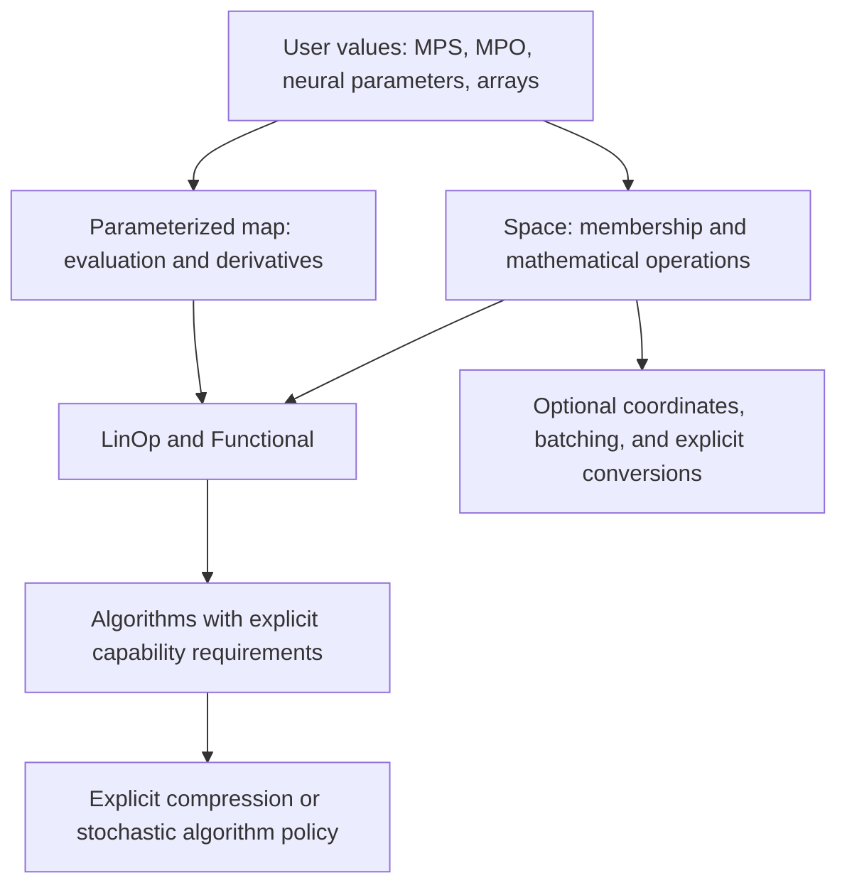

# SpaceCore as a mathematical construction and algorithm framework

Research and proposal · 26 September 2026 · proposed, not an accepted ADR

## Recommendation

SpaceCore can support the intended vision: **users construct mathematical objects, problems, and algorithms using explicit mathematical operations; representations provide the computations, and implementations can be optimized afterward.** Gradient optimization, PDHG, ADMM, and custom iterations are equal use cases. Representation support is infrastructure for this larger purpose. The existing space and operator contracts are a good foundation. The missing work includes reusable optimization operations, consistent element boundaries, genuinely optional coordinates, and a separate contract for parameterized objects.

The user's concrete targets are MPS and neural networks, including quantum optimal transport (QOT). These require two paths:

1. **Algebra on represented mathematical objects.** A user supplies membership, zero, addition, scaling, and any further operations an algorithm needs. MPS with unrestricted bond growth can follow this path.
2. **Optimization of a parameterized family.** A user supplies parameters, evaluation, and derivatives. Fixed-rank tensor networks and neural quantum states usually follow this path. Their parameter arithmetic does not implement arithmetic on the represented states.

Build these incrementally. Keep the existing backends, mathematical capability classes, operator algebra, and solver recurrences. Start with a small native-object extension and one real downstream example. A universal representation planner or a new computer algebra system would add considerable work without resolving the immediate barriers.

## 0. Clarified vision: structure the problem and the algorithm

The user's clarification changes the emphasis of the proposal. The goal is a reusable mathematical vocabulary from which users can build both problems and algorithms. MPS and neural networks are examples that test whether the vocabulary is sufficiently independent of storage.

Separate four responsibilities:

| Responsibility | What it describes | Example |
|---|---|---|
| Mathematical structure | Spaces, maps, functionals, sets, geometry, sums, compositions, constraints | `min_x g(x) + f(Kx)` |
| Algorithm | Required operations, state, update, and convergence diagnostics | PDHG, ADMM, gradient descent, a user-defined iteration |
| Representation | Native values and implementations of those operations | Arrays, trees, MPS/MPO, parameterized functions |
| Execution | Backend kernels, reusable setup, compilation, buffers, explicit approximation | Reuse a factorization; contract an MPO; compile a fixed-shape step |

These are responsibilities, not a prescription for four new class hierarchies. Existing `Space`, `Mapping`, `LinOp`, `Functional`, and lazy expression nodes already cover much of the first layer. Ordinary Python functions and small state records can express algorithms initially.

### The missing optimization operations

A `Functional` should expose optional operations required by algorithms, with precise domains and geometry. Besides `value` and `grad`, the first additions should be proximal evaluation and access to a conjugate or its proximal action. Sets should own ambient-space membership and optional metric projection; an indicator functional connects constraints to proximal methods. ADR-020 already proposes part of this surface.

For an inner-product space X, define the proximal convention explicitly:

```text
prox_f(v, t) = argmin_z f(z) + ||z-v||_X^2 / (2t),   t > 0.
```

The current proximal helpers are specialized coordinate implementations. For example, `prox_l2sq` converts its input through `ctx.asarray`, even though the unconstrained mathematical operation could use `X.scale(1/(1+t), v)` for any represented vector. Retain these helpers as kernels, and expose the mathematical operation independently of their array assumptions.

Conjugates and adjoints must use compatible dual pairings. A first implementation can use the established Hilbert-space identification and metric adjoints throughout; it should state that choice rather than mixing a coordinate dual variable with a metric adjoint. General Banach-space duality can remain a later extension.

Do not require every functional to implement every operation. Algorithms request the operations they use and identify missing ones before starting a loop. A black-box nonsmooth functional can participate in a method through a supplied prox even if no gradient exists. General ADMM can accept user-defined subproblem solvers even when no closed-form prox exists.

| Algorithm | Required mathematical operations |
|---|---|
| Gradient descent | Gradient, vector update, geometry for diagnostics |
| Proximal gradient | Smooth gradient plus nonsmooth prox |
| PDHG for `g + f o K` | `K`, metric adjoint, prox of `g`, prox of `f*`, primal/dual vector updates |
| ADMM for `f(x)+g(z)` subject to `Ax+Bz=c` | Constraint actions, two augmented subproblem solves, multiplier update, residual norms |
| Custom iteration | Precisely the operations used in its step and stopping rule |

PDHG and ADMM therefore need different operations over a common mathematical foundation. A gradient-only optimizer interface cannot serve as their universal boundary. [Chambolle–Pock primal-dual formulation](https://optimization-online.org/2010/06/2646/), [Boyd et al., ADMM](https://web.stanford.edu/~boyd/papers/admm_distr_stats.html).

### What intuitive algorithm construction means

The following is proposed interface notation, not an API already present:

```python
# Problem: min_x g(x) + f(K(x)); X and Y carry the chosen geometry.
# f_star supplies the conjugate under that geometry's pairing.
def pdhg_step(x, x_bar, y):
    y_new = f_star.prox(Y.axpy(sigma, K.apply(x_bar), y), sigma)
    x_new = g.prox(X.axpy(-tau, K.rapply(y_new), x), tau)
    x_bar_new = X.axpy(theta, X.axpy(-1, x, x_new), x_new)
    return x_new, x_bar_new, y_new
```

This update does not inspect arrays, MPS cores, or tensor shapes. It can be used with any representation implementing its required operations. A complete solver also checks its mathematical assumptions, selects admissible steps, initializes state, and reports diagnostics. For the standard convex Hilbert-space variant with extrapolation one, the familiar sufficient step-size restriction involves `tau * sigma * ||K||^2 < 1`; the norm is the one induced by the declared geometries. A sampled norm estimate is not automatically a certified upper bound.

For ADMM, keep `solve_x` and `solve_z` explicit as reusable subproblem operations, with warm starts and accuracy information where they are iterative. A general constraint matrix does not turn each ADMM subproblem into an ordinary prox of its objective term. Specialized prox updates can be selected when the particular splitting justifies them.

The repository's existing conic PDHG tutorial already illustrates algorithm assembly from an operator, projector, and dual update. Its implementation uses raw array arithmetic. Turning the same example into a reusable step over space operations is a direct first demonstration of the intended direction.

### Preserve structure so implementation can improve later

Keep sums, compositions, separable terms, and block structure inspectable rather than immediately replacing a whole problem with an opaque scalar callback. This lets a user choose a splitting and lets implementations reuse intermediates or specialize kernels. A functional may still provide an opaque callback when no structure is available.

Derive only valid identities: a separable sum over an orthogonal product space can use componentwise prox operations; an arbitrary sum cannot. A prox through an arbitrary linear composition is not obtained by simply composing proximal maps. Properties such as convexity, positive definiteness, and norm bounds should retain whether they are supplied assumptions, structurally derived facts, or numerical estimates. Unknown remains a valid state.

Resolve representation operations and prepare reusable subproblem data once before iteration. Later optimization can fuse native `axpy`, reuse factorizations, or compile the step without rewriting the mathematics. Representation constraints and approximation policy still determine whether a particular optimization is valid.

### Revised first milestone

**Implemented demonstration:** [structured optimization example](/Users/pavlopelikh/Desktop/Dev/SpaceCore/examples/structured_optimization.md).
It uses one nonsmooth least-squares problem, proximal gradient/PDHG/ADMM, dense
and native dictionary values, and interchangeable CG/prepared-factorization ADMM
subproblem solves. The example adds no core API and has 13 regression checks.

Before expanding the representation catalog, establish the full vertical example:

1. Construct one structured objective and constraint system from SpaceCore objects.
2. Implement a gradient/proximal method, PDHG, and ADMM using those objects and their respective operation contracts.
3. Run a mathematically suitable common example through all three and compare its solutions and residuals.
4. Replace dense vector values with a custom representation without editing the algorithm steps; supply the required native kernels or explicit subproblem solves.
5. Optimize one expensive kernel or reusable solve setup and confirm unchanged mathematical behavior.

Then use MPS and neural QOT as demanding follow-up cases. Their different mathematical assumptions remain explicit, but they should reuse the same construction tools. This revised milestone takes priority over interpreting the later refactor table as a representation-first feature sequence.

## 1. Scope and evidence

This assessment covers the local working tree at commit `070c090`, including pre-existing uncommitted backend typing changes. The package version is `0.4.3`, while the changelog contains unreleased architectural changes. Findings describe this checkout, not a verified PyPI release.

I used the existing graphify graph to locate space relationships, then checked the actual implementation and tests. The graph and roadmap are incomplete guides to the current tree: `docs/dev/current.md` still describes a kernel dispatch registry as implemented, but the current kernel package and the supersession notice in ADR-016 show it was removed. The proposal uses the implementation as evidence and records that documentation conflict.

Validation:

- Focused existing suite: **170 passed, 1 skipped**, covering elements, non-coordinate operators, CG, solver contracts, core resolution, algebra rules, and pytree registration. The element JAX test was skipped in the environment used.
- Runtime probes reproduced inconsistent element support, loss of bound-space information, coordinate assumptions in solver defaults, and the product-space restriction.
- A small two-site MPS experiment solved a positive-definite system using existing CG and user-supplied operations. It did not call a dense-state materializer. It converged in two iterations, with recomputed residual about `3.23e-15`; stored bond dimension grew from 2 to 13.
- The first MPS norm implementation suffered cancellation in redundant sum factors. Canonicalizing a core with QR before evaluating the squared norm made this example stable. This is evidence that representation-specific numerical kernels matter, not a performance or large-system validation.
- I inspected relevant local QOT source files in QuantumBarycenters and SDPLab. I did not run their suites. They still reference removed APIs such as `jax_pytree_class` and older context interfaces, so downstream compatibility must be restored before using them as an integration gate.

No library implementation was changed for this research. The accompanying [research probe](/Users/pavlopelikh/Desktop/Dev/SpaceCore/docs/dev/representation_vision_probe.py) records the observed behavior and contains the MPS example.

## 2. What is possible today?

| Use case | Current assessment | Main limitation |
|---|---|---|
| Dense arrays on the supported backends | Established implementation and tests | Numerical backend contracts still apply |
| Dictionaries, tuples, registered dataclasses of coordinate leaves | Supported through `TreeSpace` | Product arithmetic acts on leaves; this does not define MPS or neural-state algebra |
| Custom native object with exact vector operations | Already possible through a space subclass | Defaults, products, batching, and some algorithms still require coordinates |
| User-defined matrix-free linear map | Supported | User must provide the correct action and adjoint semantics |
| Several representations bound to the same space | Partially implemented by `Element` | Most mathematical APIs still expect raw native values; fallback densifies |
| MPS arithmetic and contractions | A small eager example works today | Rank growth, stable contractions, and representation-specific kernels remain the user's responsibility |
| Truncated MPS inside existing CG | Not a validated solver contract | Truncation changes the recurrence and can invalidate residual/convergence claims |
| Neural-network parameter optimization | Parameters can use coordinate trees and external optimizers | No general nonlinear map/pullback abstraction for the represented state |
| General QOT with MPS/MPO/neural states | Plausible research direction | Requires density-operator semantics, domain kernels, constraints, and approximation-aware algorithms |

### The good foundation

[`VectorSpace`](/Users/pavlopelikh/Desktop/Dev/SpaceCore/spacecore/space/base/_vector.py:9) only requires `zeros`, `add`, and `scale`, with a default `axpy`. Coordinates are already conceptually separate. [`InnerProductSpace`](/Users/pavlopelikh/Desktop/Dev/SpaceCore/spacecore/space/base/_inner_product.py:156) adds geometry. `LinOp` accepts vector spaces and matrix-free actions.

CG resolves space arithmetic once and uses it in the recurrence. [`resolve_core`](/Users/pavlopelikh/Desktop/Dev/SpaceCore/spacecore/linalg/_utils.py:101) deliberately respects user overrides instead of blindly invoking an inherited fast kernel. Preserve that safeguard during refactoring.

This is close to the useful pattern in pyMOR: algorithms consume abstract vector operations while the owning implementation retains its native data. pyMOR explicitly notes that conversion to NumPy can be unavailable or expensive. [pyMOR vector interface tutorial](https://docs.pymor.org/2024-1-2/tutorial_vectorarray.html).

## 3. Concrete barriers in the current implementation

### 3.1 The bound element layer is disconnected from most operations

[`Element`](/Users/pavlopelikh/Desktop/Dev/SpaceCore/spacecore/space/_element.py:26) stores a space and representation fields, but requires `densify()`. Generic addition and scaling use that dense fallback. `LowRankElement + LowRankElement` has a specialized rule that concatenates factors.

The current [`LinOp @ Element` rule](/Users/pavlopelikh/Desktop/Dev/SpaceCore/spacecore/linop/_algebra.py:1153) is effectively:

```python
DenseElement._make(A.codomain, A.apply(x.densify()))
```

Consequences confirmed by probes:

- `A @ DenseElement(...)` works, but `A.apply(element)`, `X.inner(element, element)`, `F(element)`, and `cg(A, element)` fail membership checks in the dense space.
- Even `IdentityLinOp @ LowRankElement` produces a dense element.
- The rule does not compare `x.space` with `A.domain`. An element bound to a weighted space can pass into a Euclidean operator with matching array shape, because its ownership is discarded before validation.

For large MPS, an implicit dense fallback can make a mathematically simple operation exponentially expensive. Merely adding an `MPSElement` subclass with a `densify` method would preserve this problem.

### 3.2 Coordinates are optional in the hierarchy but required elsewhere

- [`default_maxiter`](/Users/pavlopelikh/Desktop/Dev/SpaceCore/spacecore/linalg/_utils.py:43) reads `domain.shape`.
- [`default_initial_vector`](/Users/pavlopelikh/Desktop/Dev/SpaceCore/spacecore/linalg/_utils.py:202) reads `shape` and calls `unflatten`; strict CG invokes it even when `maxiter` is supplied.
- Lanczos stores flattened basis vectors; exponential action uses that coordinate machinery. These need either explicit coordinate requirements or an independently justified native basis implementation.
- [`TreeSpace`](/Users/pavlopelikh/Desktop/Dev/SpaceCore/spacecore/space/concrete/_tree_space.py:227) requires coordinate-space leaves and derives all flat sizes at construction.
- Batching capability is currently an alias for `CoordinateSpace`, so even explicit non-coordinate batch callbacks are rejected.
- [`Functional`'s type parameter](/Users/pavlopelikh/Desktop/Dev/SpaceCore/spacecore/functional/_base.py:18) is bounded by `CoordinateSpace`, although scalar evaluation itself does not require coordinates.

A custom object can already work in ordinary CG with an explicit iteration limit. It currently fails with the default limit and in strict mode because of the two helper functions above.

### 3.3 Storage, coordinates, and mathematical dimension are conflated

`flatten` serves as both a storage operation and a coordinate chart. These are different for constrained representations.

For example, [`HermitianSpace.unflatten`](/Users/pavlopelikh/Desktop/Dev/SpaceCore/spacecore/space/concrete/_hermitian.py:167) reshapes and symmetrizes. For a real 2-by-2 symmetric matrix, storage size is 4 but real vector-space dimension is 3. Flattening after unflattening an arbitrary four-vector changes it. The existing round-trip works on valid represented members; it is not a bijection onto all storage vectors.

MPS factor entries introduce much more redundancy through gauge transformations. Neural parameters can represent the same function in multiple ways. Counting storage entries cannot supply an intrinsic dimension or a unique coordinate system for those objects.

### 3.4 Equality currently includes the representation's execution context

[`ContextBound.same_math`](/Users/pavlopelikh/Desktop/Dev/SpaceCore/spacecore/contextual/_bound.py:46) requires the same concrete class, backend, and dtype. It is an execution compatibility gate, despite its name. This conservative behavior protects array operations and should not simply be relaxed.

For the first MPS extension, use the same owning space and explicit native kernels. If cross-basis or cross-backend mathematical identity becomes necessary, introduce an explicit identification/map separately from execution compatibility. Equal array shapes, equal physical dimensions, or abstract isomorphism alone do not authorize mixing objects.

### 3.5 Membership and transform contracts need strengthening

`LowRankElement` checks factor shapes and real weights, but ordinary construction does not comprehensively validate factor backend, dtype, and field against the owning space. A complex factor was accepted in a real Hermitian space and failed only on subsequent densification.

`TreeElement` is also a separate wrapper rather than an implementation of the general element interface. Its constructor checks ownership type and arity; leaf membership is handled later by the space.

Representations retain mutable arrays. “Checked once” is only sound under a documented ownership/mutation rule. Do not add automatic conversion caches while externally held arrays can change without invalidation.

JAX integration is a second contract: pytree registration enables traversal, but does not make every algorithm compilable. Auxiliary metadata needs meaningful equality and hashing, and `while_loop` requires fixed tree structure, shapes, and dtypes. Growing MPS ranks violate the latter. Its reverse-mode limitation also means that “JIT-compatible solve” does not imply “differentiable through the solve.” [JAX pytrees](https://docs.jax.dev/en/latest/101/pytrees.html), [JAX while-loop contract](https://docs.jax.dev/en/latest/_autosummary/jax.lax.while_loop.html).

## 4. The mathematical contract for MPS and neural networks

### MPS: physical vector arithmetic and factor arithmetic differ

An MPS contracts local tensors into a vector. Elementwise addition of corresponding cores generally does not add the represented vectors.

An exact sum can use direct sums of bonds, increasing their stored dimensions. The simple witness is `|00> + |11>`: both summands have bond dimension 1, while the sum needs bond dimension 2. A fixed bond cap is therefore not closed under addition. A normalized-state family also excludes the zero vector and arbitrary scaling.

Use the ambient Hilbert space for exact vector operations, permitting varying ranks. Represent fixed-rank optimization separately. Keep canonicalization/gauge changes that preserve the represented value distinct from truncation that approximates it. Tensor-network references describe contractions and controlled compression; fixed-rank tensor-train optimization has a separate manifold treatment. [MPS operations](https://tensornetwork.org/mps/), [Riemannian optimization of fixed-rank representations](https://arxiv.org/abs/2103.14974).

### Neural networks: parameters and represented objects need separate spaces

Write the ansatz as `Phi: P -> X`, with parameters `theta` in `P` and represented state `Phi(theta)` in `X`.

In general:

```text
Phi(theta1 + theta2) != Phi(theta1) + Phi(theta2)
```

A tree of network weights is a valid parameter vector space. It is not thereby the Hilbert space of network outputs. A lazy sum of two networks can represent the sum of their outputs, but enlarges the representation and still needs an implementable inner product. Evaluation alone does not provide integrals, normalization, or adjoints.

For neural optimization, use derivatives at the current parameter value: `J_theta = D Phi(theta)`. This is a linear map between parameter perturbations and ambient perturbations, even when `Phi` is nonlinear. Do not promise that every parameterized family is a smooth manifold globally; rank changes, symmetries, and singular points complicate that statement.

NetKet is a relevant example: its quantum geometric tensor depends on the current variational state, and stochastic reconfiguration uses this geometry to precondition parameter updates. This supports a parameter-dependent geometry API rather than assigning a single fixed geometry to the full family. [NetKet geometry and stochastic reconfiguration](https://netket.readthedocs.io/en/stable/user-guides/sr.html).

### Approximation changes the algorithm's contract

An operation such as `compress(x, tolerance, max_bond)` should be explicit. Its result should report the achieved rank and whatever error bound or estimate is actually available. A rigorous bound, a heuristic discarded-weight estimate, and a Monte Carlo standard error must not be presented as equivalent guarantees.

Do not hide compression inside a method claiming ordinary vector addition. An inexact algorithm may explicitly request compressed additions, but must specify how errors are budgeted and how the final residual is checked. Likewise, re-sampling every application of a nominal `LinOp` can make it a changing stochastic action, not the fixed operator assumed by CG. For a sampled parameter-space metric solve, freeze the sample set for that solve and test/regularize the resulting operator as needed.

## 5. Proposed architecture



### 5.1 Make native values the primary extension point

Keep space subclasses as the initial extension mechanism. A user should implement only the mathematical operations the chosen algorithm consumes:

| Contract | Minimum useful operations |
|---|---|
| A general set of objects | membership |
| Vector space | membership, zero, addition, scalar multiplication |
| Inner-product space | vector operations and inner product |
| Linear action | source/target spaces and forward application |
| Adjoint action | chosen inner products and the corresponding adjoint |
| Coordinates | explicit packing/reconstruction with a documented coordinate domain |
| Differentiable parameterization | parameter space, evaluation, and JVP/VJP when needed |
| Compression | requested tolerance/rank and reported approximation information |

For MPS, local tensors can use NumPy/JAX/Torch operations without inventing an “MPS backend.” The tensor library supplies contraction kernels; SpaceCore supplies mathematical composition and contracts. An adapter must define mutation/ownership, scalar conventions, normalization, and whether returned objects preserve the input representation.

Add element type parameters incrementally (`VectorSpace[T]`, native input/output types), while keeping runtime checks authoritative. Do not make a foreign tensor or neural library subclass SpaceCore classes if a space adapter can supply the operations.

### 5.2 Unify raw values and bound elements

Retain optional elements as bindings between a native value and its owning space. Keep specialized dense/low-rank classes as conveniences. Establish one shared interface for retrieving the binding and native representation; it must not require densification.

Proposed behavior:

- Raw inputs continue through native operations and return native results.
- Bound inputs validate the owning space, use the same native operation, and bind outputs to the result space. Scalar-valued results stay scalars.
- `A @ x`, `A(x)`, and `A.apply(x)` share this path. Inner products, functionals, and solver boundaries follow the same convention.
- Solver boundaries unwrap once, run the existing native recurrence, and restore the output binding. Preserve `resolve_core`'s protection of overrides.
- Unavailable representation combinations raise an actionable error. Dense materialization and representation conversion are explicit operations or explicitly chosen adapter behavior.

Input adaptation must run even at `check_level='none'`; that setting controls optional validation, not which mathematical operation is performed. Keep cheap ownership guards distinct from expensive membership probes. Avoid hiding conversion in the validation decorator.

A safe migration starts with one shared bound-input helper and an explicit element-application path, then routes built-ins through it. Add compatibility coverage for third-party subclasses overriding public `apply`, `inner`, and `axpy` before changing their expected hooks.

### 5.3 Remove accidental capability requirements

1. For non-coordinate CG/LSQR, require explicit `maxiter` when no justified default is available. Do not use the number of MPS parameters as Hilbert dimension.
2. Reuse the existing non-coordinate probe mechanism, or accept user probes, in strict checks. Report skipped diagnostics; a probe is evidence, not proof of positive definiteness.
3. Let `SpaceCoreOps` honor a specialized `axpy`, resolving it once like the other operations. Today it rebuilds `axpy` from addition and scaling, preventing an MPS adapter from using a fused implementation.
4. Generalize product spaces to vector-space leaves. Expose coordinate operations only when all leaves supply them. Reuse the existing tree traversal and capability intersection instead of maintaining a second tree engine. Preserve a coordinate specialization for existing users.
5. Split batching from coordinates when implementing the MPS product/batch use case. Eager collections and fixed-shape array batches need not have identical storage contracts.
6. Widen the base functional contract to general spaces; request inner products, coordinates, or spectral calculus only where needed. Keep coordinate `Lp` norms explicitly coordinate-defined.
7. Mark coordinate-based Lanczos/exponential routines clearly. A native Krylov basis implementation is a separate feature, not a prerequisite for every extension.

An inner product alone should not silently assert an implemented Riesz map in an arbitrary representation. The current `InnerProduct` defaults return their input for both Riesz operations. Preserve this for explicitly Euclidean geometry; require an explicit implementation or capability before doing a metric-to-coordinate handoff for custom geometry.

### 5.4 Add a small nonlinear map interface for the stated neural use case

Build a concrete differentiable-map extension around the existing `Mapping` base:

```text
Phi.domain                 parameter space P
Phi.codomain               represented-object space X
Phi.evaluate(theta)        native represented object
Phi.linearize(theta)       J_theta as a LinOp, when available
```

`linearize` can use supplied JVP/VJP callbacks; automatic differentiation is an optional adapter. For an objective already computed directly from parameters, wrapping its value and gradient as a `Functional(P)` is the simplest first implementation and needs no new general map class.

When ambient differentiation is available, the pullback identity is:

```text
grad_P(F o Phi)(theta) = J_theta^sharp grad_X F(Phi(theta))
J_theta^sharp = R_P^{-1} J_theta^dagger R_X
```

Here `dagger` denotes the coordinate adjoint/VJP under the stated coordinate pairings. An autodiff VJP produces a parameter covector; it is not automatically the metric gradient. For complex neural parameters and real objectives, specify the real differential/pairing and test against real and imaginary perturbations. Reuse the existing metric handoff logic rather than introducing a second convention.

A Jacobian-as-operator abstraction is established in Lineax; its operator API also distinguishes matrix, callable, and pytree representations. The architectural lesson is to expose the derivative action without constructing a dense Jacobian. [Lineax operator documentation](https://docs.kidger.site/lineax/api/operators/).

For natural-gradient experiments, construct the parameter-space metric action at the current `theta`; add damping when it is singular or nearly singular. A semidefinite QGT is not an SPD operator merely because it is called a metric.

### 5.5 Keep dispatch and conversion small and explicit

Use native space methods first. Where mixed representation rules are needed, extend the existing small algebra rule mechanism rather than resurrecting the removed benchmarked kernel registry. Its current left-first MRO lookup is deterministic but is not symmetric “most specific pair” dispatch; duplicate registrations overwrite silently. Define and test overlap/duplicate behavior before making it a public plugin contract.

CoLA demonstrates structure-aware operator rules. The useful lesson is specializing concrete actions and compositions, not importing its entire dispatch design. [CoLA extension guide](https://cola.readthedocs.io/en/stable/notebooks/Adding_Linear_Operators.html).

Distinguish three explicit changes:

- **Storage conversion:** another representation of the same value.
- **Context conversion:** backend/device/precision movement; rounding may occur.
- **Approximation:** compression or fitting that changes the represented value.

Keep mathematical identifications, such as a change of basis, explicit as well. If `c_new = T c_old`, the metric must transform as `G_new = T^{-H} G_old T^{-1}`. A reshape is not generally a basis change. Sage's distinction between arbitrary conversion and consistent structure-preserving coercion is a useful precedent. [Sage parents and coercion](https://doc.sagemath.org/html/en/tutorial/tour_coercion.html).

Full symbolic/rational support is a further scope expansion: the current base space requires floating storage and derives entry field from dtype. SymPy's separation of algebraic domain and dense/sparse representation is informative, but adding a SymPy-valued backend would not by itself repair that numerical contract. [SymPy DomainMatrix](https://docs.sympy.org/latest/modules/polys/domainmatrix.html).

## 6. What QOT specifically needs

The inspected QuantumBarycenters code already expresses the marginal operator as a `MatrixFreeLinOp`, which is a good seam. However, its actions explicitly reshape dense matrices and use dense `einsum` to compute partial traces and Kronecker sums. Its space constructors select dense `HermitianSpace` leaves. See [marginal and barycenter actions](/Users/pavlopelikh/Desktop/Dev/QuantumBarycenters/barycenter/qot/qot.py:35) and [primal/dual space construction](/Users/pavlopelikh/Desktop/Dev/QuantumBarycenters/barycenter/qot/space.py:55).

Preserve the mathematical QOT operator, and inject representation-specific actions for:

| Operation | Why the representation matters |
|---|---|
| Trace and cost pairing | Requires efficient contractions or explicitly estimated expectations |
| Partial traces | Must preserve subsystem ordering and return declared marginal spaces |
| `U tensor I + I tensor V` | Needs an MPO/native construction with controlled rank growth |
| Positivity and normalization | An arbitrary MPO or MPS does not establish both |
| Entropy and Gibbs/spectral operations | Generic many-body spectra and matrix exponentials are not made cheap by an interface |
| Differentiation | Requires contractions/JVP/VJP or an explicitly specified stochastic estimator |
| Compression and residuals | Must track approximation separately from feasibility |

### Use the correct represented object

An ordinary MPS represents a vector/pure state. A QOT coupling is a positive semidefinite operator on a tensor-product Hilbert space. A general coupling is mixed. Suitable routes include an MPO with an appropriate positivity mechanism or a purification `Gamma = L L*`, where `L` itself has a tensor-network representation. Normalize when the model requires trace one. Neural density models need an analogous construction; a scalar wavefunction evaluator is not a general mixed-state coupling.

Locally purified tensor-network methods provide a precedent for maintaining positivity through representation. That supports a purification adapter; it does not prove that a particular QOT compression algorithm retains its other constraints. [Werner et al., positive tensor-network approach](https://arxiv.org/abs/1412.5746).

### Two honest QOT execution modes

**Ambient mode:** the existing convex problem is expressed over its density-operator space, with native tensor contractions replacing dense kernels. Any truncation must be incorporated into an inexact algorithm with explicit error accounting. General cost operators and noncommuting exponentials may still require prohibitive ranks. Confirm locality, subsystem structure, and kernel availability for the chosen problem before promising scalability.

**Variational mode:** choose `Gamma_theta = Phi(theta)` and optimize `F(Phi(theta))` with marginal constraints `A(Phi(theta)) = b`. A penalty or augmented-Lagrangian outer method can use the composed constraint Jacobian `A J_theta` and its pullback. Positivity can be built into `Phi`, but matching both marginals remains an additional requirement. Barycenter problems also parameterize the shared density variable consistently.

The variational family restricts the feasible set and introduces nonconvex optimization. Report that changed problem, rather than claiming the optimum or convergence guarantee of the unrestricted convex QOT formulation. The cited convex QOT research establishes results under its own hypotheses; those results do not automatically transfer to truncation or neural parameterization. [Caputo et al., quantum optimal transport with convex regularization](https://arxiv.org/abs/2409.03698).

For entropy-regularized QOT, treat entropy/Gibbs evaluation as its own research milestone. Start by validating cost, marginals, positivity, and derivatives. A tractable quadratic-regularized pilot can validate the interfaces first, but it must be labeled as a different regularizer, not a substitute result for entropic QOT.

### First downstream experiment

Use a small bipartite problem with a dense reference, a purification/tensor-network representation, and a neural parameterization. Test each contraction and derivative against dense values before optimization. Record objective, each marginal residual, trace error, positivity evidence, rank, runtime/memory, approximation tolerance, and sampling uncertainty when applicable. Check for dense-state allocation with a materialization sentinel.

A feasible primal point supplies an upper bound in a minimization problem; a dual lower bound requires actual dual feasibility. A small sampled residual or a truncated PSD check is not automatically a certificate.

Keep tensor-network kernels and QOT-specific constraints in an adapter/downstream package. The reusable contracts and compatibility fixes belong in SpaceCore.

## 7. Refactor order and acceptance gates

| Step | Change | Main files | Gate |
|---|---|---|---|
| 1 | Make element entry points consistent; validate ownership; remove implicit materialization from the new native path | `space/_element.py`, `linop/_algebra.py`, native public wrappers | `A @ x`, `A(x)`, and `A.apply(x)` agree; wrong-space inputs fail; identity preserves MPS/low-rank values |
| 2 | Make CG/LSQR/probes and products work with non-coordinate objects; honor native `axpy` | `linalg/_utils.py`, `space/_capabilities.py`, `space/concrete/_tree_space.py`, functional bounds | External MPS adapter runs without `shape`, `flatten`, or dense conversion; strict checks have explicit probe behavior |
| 3 | Validate exact and approximate MPS paths separately; document eager versus compiled support | Extension example plus adapter | Rank growth visible; stable contractions; no hidden truncation; JAX path has fixed carry structure or is explicitly unsupported |
| 4 | Add parameterized objective/pullback example, then extract the minimal reusable map API | `mapping.py`, `functional/_composed.py`, optimizer boundary | Directional derivatives agree with finite differences; metric correction and complex conventions tested |
| 5 | Run the small QOT comparison and only then choose scalable approximations | QuantumBarycenters/SDPLab and adapter | Same primitive operations as dense reference; feasibility and approximation reported independently |
| Later | Intrinsic coordinate charts, cross-representation identities, optional native Lanczos basis | Coordinate and equality APIs | Required by a demonstrated second use case; documented migration |

Steps 1–2 are bounded core engineering. Step 3 includes representation-specific numerical work. Step 4 is a moderate API extension if limited to one neural use case. Step 5, particularly entropy at scale, is research; a credible schedule needs a specified ansatz, cost structure, target size, and error budget.

Move extension work ahead of broad new solver coverage. Update `docs/dev/current.md` and the affected ADRs when the design is accepted. Avoid silently changing existing `__eq__`, dense return types, or conversion defaults during this migration; provide compatibility tests and a deprecation path for changed fallback behavior.

## 8. Validation that establishes the vision

The decisive acceptance test is an extension implemented outside the SpaceCore package, with native values that cannot be flattened or converted to dense arrays, successfully using the intended algorithms.

Tests should cover:

1. Vector-space laws and membership under exact native operations, within justified floating-point tolerances.
2. Adjoint identity and objective directional derivatives for the actual geometry.
3. Agreement between raw and bound entry points, including wrong-space rejection.
4. Mixed-representation output rules and explicitly unavailable conversions.
5. An MPS whose addition increases bond dimension, and explicit compression with verified small-system error.
6. Neural parameter addition versus state addition, plus a correct nonlinear pullback.
7. Product spaces with non-coordinate leaves and honest capability errors from coordinate-only routines.
8. JIT/gradient tests only for representations that satisfy the backend's shape and differentiation contract.
9. No dense materialization at production sizes; dense references only in bounded tests.
10. Downstream migration and end-to-end QOT checks after restoring current API compatibility.

The first research milestone should be **one MPS adapter and one neural parameterization using the same mathematical problem description**, with their different solver assumptions explicit. That would establish the intended architecture more convincingly than adding many built-in representation classes.
