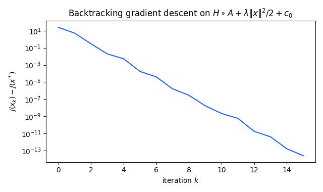

3 · Functionals and gradient descent
====================================

**Goal:** write a functional from check-free cores, assemble a robust
regression objective with the functional algebra, verify its gradient,
and minimise it with a hand-written gradient-descent loop.

**Before you start:** :doc:`02_linear_algebra`; the chain rule for a
composition with a linear map. Run the code blocks in order in a fresh
session; see :doc:`index` for setup.

1 · Elements, and a built-in quadratic
--------------------------------------

A functional is a map :math:`F:X\to\mathbb R`. Its argument is an
element of the space X, and its gradient is another element of X. The
built-in ``LinOpQuadraticForm(Q, linear, a)`` represents

.. math::

   F(x)=\tfrac12\langle x,Qx\rangle_X+\langle c,x\rangle_X+a,
   \qquad \nabla F(x)=Qx+c.

For a symmetric positive-definite Q, the gradient vanishes exactly at
:math:`x^\star=-Q^{-1}c`.

.. code:: python

    import numpy as np
    import matplotlib.pyplot as plt
    import scipy.optimize
    import spacecore as sc

    ctx = sc.Context(sc.NumpyOps(), dtype=np.float64)
    ops = ctx.ops
    X = sc.DenseVectorSpace((3,), ctx)

    x = ctx.asarray([1.0, 2.0, 3.0])
    c = ctx.asarray([1.0, 0.0, -1.0])
    X.check_member(x)
    try:
        X.check_member(ctx.asarray([1.0, 2.0]))
    except sc.SpaceValidationError as err:
        print("rejected:", err)

    Q = sc.DiagonalLinOp(ctx.asarray([2.0, 3.0, 5.0]), X, ctx)
    quad = sc.LinOpQuadraticForm(Q, sc.InnerProductFunctional(c, X), a=0.5)

    np.testing.assert_allclose(quad.value(x), 0.5 * (2 + 12 + 45) + (1 - 3) + 0.5)
    np.testing.assert_allclose(quad.grad(x), Q.apply(x) + c)
    x_star = -c / ctx.asarray([2.0, 3.0, 5.0])
    np.testing.assert_allclose(quad.grad(x_star), X.zeros(), atol=1e-15)

``check_member`` accepts the length-3 array and rejects the length-2
array with ``SpaceValidationError``. The three assertions confirm the
value, the gradient formula, and the stationary point.

2 · Write your own functional from cores
----------------------------------------

The pseudo-Huber misfit on a data space Y with data b and scale
:math:`\delta>0` is

.. math::

   H(y)=\delta^2\sum_i\Big(\sqrt{1+r_i^2}-1\Big),\qquad r=(y-b)/\delta,
   \qquad \frac{\partial H}{\partial y_i}=\frac{\delta\, r_i}{\sqrt{1+r_i^2}}.

It is quadratic for small residuals and grows like
:math:`\delta|y_i-b_i|` for large ones, so outliers pull less than in
least squares.

Subclass ``Functional`` and implement the check-free cores only. The
inherited public ``value``, ``grad`` and ``value_and_grad`` check the
input and output and then call them. ``_grad_core`` must return the
Riesz gradient, so it passes the coordinate derivative through
``self.domain.riesz_inverse``. ``_value_and_grad_core`` shares the
residual between the two outputs.

.. code:: python

    class PseudoHuber(sc.Functional):
        """H(y) = delta^2 * sum(sqrt(1 + ((y - b)/delta)^2) - 1)."""

        _fields = ("b", "delta", "dom", "ctx")
        _dynamic = ("b",)

        def __init__(self, b, delta, dom, ctx=None, check_level=None):
            super().__init__(dom, ctx, check_level=check_level)
            if not np.isfinite(delta) or delta <= 0:
                raise ValueError("delta must be finite and positive")
            self.b = self.ctx.asarray(b)
            self.domain.check_member(self.b)
            self.delta = delta

        def _residual(self, y):
            return (y - self.b) / self.delta

        def _value_core(self, y):
            r = self._residual(y)
            return self.delta**2 * self.ops.sum(self.ops.sqrt(1 + r * r) - 1)

        def _grad_core(self, y):
            r = self._residual(y)
            return self.domain.riesz_inverse(self.delta * r / self.ops.sqrt(1 + r * r))

        def _value_and_grad_core(self, y):
            r = self._residual(y)
            s = self.ops.sqrt(1 + r * r)
            value = self.delta**2 * self.ops.sum(s - 1)
            return value, self.domain.riesz_inverse(self.delta * r / s)

    rng = np.random.default_rng(0)
    m, n = 40, 3
    Y = sc.DenseVectorSpace((m,), ctx)
    b = ctx.asarray(rng.standard_normal(m))
    H = PseudoHuber(b, 0.5, Y)

    y = ctx.asarray(rng.standard_normal(m))
    d = ctx.asarray(rng.standard_normal(m))
    h = 1e-6
    slope = (H.value(Y.axpy(h, d, y)) - H.value(Y.axpy(-h, d, y))) / (2 * h)
    np.testing.assert_allclose(slope, Y.inner(H.grad(y), d), rtol=1e-7)
    value, grad = H.value_and_grad(y)
    np.testing.assert_allclose(value, H.value(y))
    np.testing.assert_allclose(grad, H.grad(y))

The central difference of ``H`` along ``d`` matches
:math:`\langle\nabla H(y),d\rangle_Y` to relative error :math:`10^{-7}`.
The fused core returns the same pair as the separate cores, which the
``value_and_grad`` contract requires.

3 · Assemble the objective with the algebra
-------------------------------------------

Fit :math:`x\in X=\mathbb R^3` to data :math:`b\approx Ax`, where a few
entries of b are gross outliers. The objective is

.. math::

   J(x)=H(Ax)+\lambda\cdot\tfrac12\|x\|_X^2+c_0,
   \qquad
   \nabla J(x)=A^\#\,\nabla H(Ax)+\lambda x.

The first term is a pullback: ``H @ A`` evaluates A, then H, and the
chain rule applies the adjoint ``A.H`` to the inner gradient.
``SquaredL2NormFunctional`` is :math:`\tfrac12\|x\|_X^2` with gradient
x, and adding the scalar :math:`c_0` shifts the value without changing
the gradient.

.. code:: python

    X = sc.DenseVectorSpace((n,), ctx)
    A = sc.DenseLinOp(ctx.asarray(rng.standard_normal((m, n))), X, Y, ctx)
    x_true = ctx.asarray([1.0, -2.0, 0.5])
    b = A.apply(x_true) + 0.05 * ctx.asarray(rng.standard_normal(m))
    b[:4] += 8.0                                      # four gross outliers

    lam, c0 = 0.1, 2.0
    H = PseudoHuber(b, 0.5, Y)
    J = H @ A + lam * sc.SquaredL2NormFunctional(X) + c0
    print(J.terms)

    x = ctx.asarray(rng.standard_normal(n))
    np.testing.assert_allclose(J.value(x), H.value(A.apply(x)) + 0.5 * lam * X.inner(x, x) + c0)
    chain_rule = X.axpy(lam, x, A.H.apply(H.grad(A.apply(x))))
    np.testing.assert_allclose(J.grad(x), chain_rule)

    d = ctx.asarray(rng.standard_normal(n))
    slope = (J.value(X.axpy(h, d, x)) - J.value(X.axpy(-h, d, x))) / (2 * h)
    np.testing.assert_allclose(slope, X.inner(J.grad(x), d), rtol=1e-7)

``J`` is a lazy ``SumFunctional`` of a ``ComposedFunctional``, a
``ScaledFunctional`` and a ``ConstantFunctional``; only ``PseudoHuber``
needed custom code. Its gradient equals the hand-derived chain-rule
formula, and the finite-difference slope confirms both sign and scale.

4 · Gradient descent with backtracking
--------------------------------------

The update is :math:`x_{k+1}=x_k-t_k\nabla J(x_k)`. Start each step at
:math:`t=1` and halve it until the Armijo condition

.. math::

   J(x_k-t\nabla J(x_k))\le J(x_k)-\tfrac12\,t\,\|\nabla J(x_k)\|_X^2

holds. J is strongly convex (the :math:`\lambda` term) with Lipschitz
gradient, so the accepted steps are bounded below and the iterates
converge to the unique minimiser. Stop at :math:`\|\nabla J\|_X<10^{-6}`:
the Armijo decrease :math:`t\|\nabla J\|^2/2` then falls to the
rounding level of J, about :math:`10^{-15}|J|`, and no smaller gradient
is reliably reachable.

.. code:: python

    x = X.zeros()
    values = []
    for iteration in range(2000):
        value, grad = J.value_and_grad(x)
        values.append(float(value))
        gnorm = float(X.norm(grad))
        if gnorm < 1e-6:
            break
        t = 1.0
        for _ in range(60):
            candidate = X.axpy(-t, grad, x)
            if J.value(candidate) <= value - 0.5 * t * gnorm**2:
                break
            t *= 0.5
        else:
            raise RuntimeError("backtracking found no decrease")
        x = candidate
    else:
        raise RuntimeError("gradient tolerance not reached")

    reference = scipy.optimize.minimize(
        lambda v: float(J.value(ctx.asarray(v))), np.zeros(n),
        jac=lambda v: np.asarray(J.grad(ctx.asarray(v))),
        method="BFGS", options={"gtol": 1e-9},
    )
    np.testing.assert_allclose(x, reference.x, atol=1e-7)
    np.testing.assert_allclose(values[-1], reference.fun, rtol=1e-12)
    assert np.all(np.diff(values) <= 0)
    print("iterations:", iteration, " x:", x, " x_true:", x_true)

    fig, ax = plt.subplots(figsize=(6.4, 3.8))
    ax.semilogy(np.array(values[:-1]) - values[-1], color="#2563eb")
    ax.set_xlabel("iteration $k$")
    ax.set_ylabel("$J(x_k) - J(x^*)$")
    ax.set_title("Backtracking gradient descent on $H\\circ A + \\lambda\\|x\\|^2/2 + c_0$")
    plt.tight_layout(); plt.show()

The loop touches x only through ``X.axpy`` and ``X.norm``, and the
gradient through ``value_and_grad``. It agrees with SciPy's BFGS to
:math:`10^{-7}` in x, and the recorded values never increase. The gap
decays linearly on the log scale, the rate expected for a strongly
convex objective. The estimate stays close to ``x_true`` despite the
four outliers: each entry of the coordinate derivative of H has
magnitude below :math:`\delta`, however large the residual.

5 · Gradients respect the geometry
----------------------------------

Give the data space the weighted inner product
:math:`\langle u,v\rangle_W=\sum_iw_iu_iv_i`. The coordinate derivative
:math:`\partial H/\partial y` does not depend on W, but the Riesz
gradient does:

.. math::

   \nabla_W H(y)=W^{-1}\frac{\partial H}{\partial y},
   \qquad
   dH(y)=W\,\nabla_W H(y)=\frac{\partial H}{\partial y}.

``grad`` returns :math:`\nabla_W H`; ``differential`` returns the
coordinate covector dH, paired with directions by the plain sum.

.. code:: python

    w = ctx.asarray(np.linspace(1.0, 5.0, m))
    Yw = sc.DenseVectorSpace((m,), ctx, geometry=sc.WeightedInnerProduct(w))
    Hw = PseudoHuber(b, 0.5, Yw)

    y = ctx.asarray(rng.standard_normal(m))
    coordinate = H.grad(y)                       # Euclidean Y: gradient = coordinate derivative
    assert not np.allclose(Hw.grad(y), coordinate)
    np.testing.assert_allclose(Hw.grad(y), coordinate / w)
    np.testing.assert_allclose(Hw.differential(y), coordinate)

    d = ctx.asarray(rng.standard_normal(m))
    slope = (Hw.value(Yw.axpy(h, d, y)) - Hw.value(Yw.axpy(-h, d, y))) / (2 * h)
    np.testing.assert_allclose(slope, Yw.inner(Hw.grad(y), d), rtol=1e-7)
    assert not np.isclose(slope, Y.inner(Hw.grad(y), d), rtol=1e-3)

    Aw = sc.DenseLinOp(A.A, X, Yw, ctx)
    Jw = Hw @ Aw + lam * sc.SquaredL2NormFunctional(X) + c0
    x = ctx.asarray(rng.standard_normal(n))
    np.testing.assert_allclose(Jw.grad(x), J.grad(x))

The finite-difference slope matches :math:`\langle\nabla_WH,d\rangle_W`
and fails against the Euclidean pairing, so the weighted gradient is
correct only in its own inner product. The last assertion shows the
metric on Y cancelling in the pullback: :math:`A^\#=A^\top W` on
:math:`X\to Y_W`, and :math:`A^\top W\,W^{-1}\partial H=A^\top\partial H`.
Changing the metric of X, by contrast, changes the descent direction;
:doc:`05_weighted_tikhonov` uses this as a preconditioner.

Check your understanding
------------------------

* Remove ``_value_and_grad_core`` from ``PseudoHuber``. Does
  ``H.value_and_grad`` still work? Yes: the base class combines the two
  separate cores.
* Replace ``self.domain.riesz_inverse(...)`` in ``_grad_core`` by the
  bare coordinate derivative. Which assertion in §5 fails first? The
  first one, ``not np.allclose(Hw.grad(y), coordinate)``; on Euclidean
  Y nothing changes.
* Change ``0.5`` in the Armijo test to ``1.0``. Why does backtracking
  never terminate? Along -g the decrease is
  :math:`t\|g\|^2-O(t^2)`, which is strictly below :math:`t\|g\|^2`
  wherever J curves upward.

**Next:** :doc:`4 · Tree spaces <04_tree_spaces>` — structured
elements and block operators.
