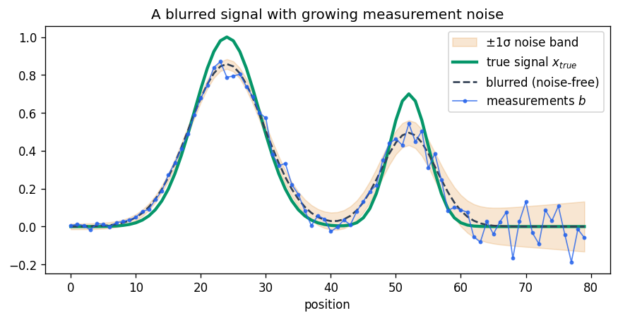
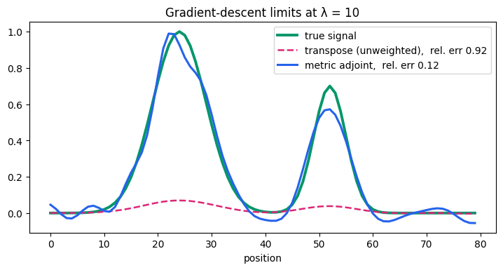
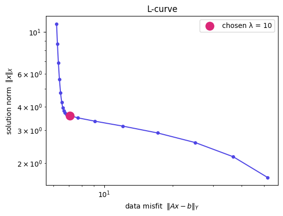

5 · Weighted Tikhonov: an inverse problem with metric adjoints
==============================================================

**Goal:** build a weighted Tikhonov objective from functionals on two
weighted spaces, check its gradient, and minimise it with a hand-written
gradient descent whose answer matches the metric normal equations.

**Before you start:** read :doc:`02_linear_algebra` and :doc:`03_functionals`.
Run the code blocks in order in a fresh session; see :doc:`index` for setup.

We deblur a noisy signal: we observe :math:`b \approx A x`, where A is a
blur and the measurement noise is heteroscedastic. We recover x by
minimising

.. math::

   J(x)=\tfrac12\lVert Ax-b\rVert_Y^2+\tfrac{\lambda}{2}\lVert x\rVert_X^2,
   \qquad \lVert y\rVert_Y^2=\sum_i y_i^2/\sigma_i^2,\quad
   \lVert x\rVert_X^2=\sum_j m_j x_j^2.

The Y norm weights measurement i by its precision :math:`1/\sigma_i^2`;
the X norm with weights m is a prior. Both norms are non-Euclidean, and
that changes the adjoint of A.

.. code:: python

    import numpy as np
    import matplotlib.pyplot as plt
    import spacecore as sc

    # Colours used in the plots below.
    BLUE, INDIGO, CYAN = "#2563eb", "#4f46e5", "#0891b2"
    PINK, AMBER, GREEN = "#db2777", "#d97706", "#059669"
    SLATE, GRID = "#334155", "#e5e9f0"

    ctx = sc.Context(sc.NumpyOps(), dtype=np.float64)
    ops = ctx.ops

1 · The forward problem
-----------------------

A clean signal :math:`x_\text{true}` is blurred by a row-normalised
Gaussian kernel and corrupted by noise whose standard deviation grows
from 0.015 on the left to about 0.13 on the right.

.. code:: python

    n = 80
    grid = np.arange(n)
    x_true = (np.exp(-0.5*((grid - 24)/5)**2) + 0.7*np.exp(-0.5*((grid - 52)/3)**2))

    blur = np.exp(-0.5*((grid[:, None] - grid[None, :]) / 3.0)**2)
    M = blur / blur.sum(axis=1, keepdims=True)
    sigma = 0.015 + 0.12 * (grid / n)**2                     # noise grows to the right
    rng = np.random.default_rng(1)
    clean = M @ x_true
    b = clean + sigma * rng.standard_normal(n)

    fig, ax = plt.subplots(figsize=(8.6, 3.8))
    ax.fill_between(grid, clean - sigma, clean + sigma, color=AMBER, alpha=0.18,
                    label="±1σ noise band")
    ax.plot(grid, x_true, color=GREEN, lw=2.6, label="true signal $x_{true}$")
    ax.plot(grid, clean, color=SLATE, lw=1.6, ls="--", label="blurred (noise-free)")
    ax.plot(grid, b, color=BLUE, lw=1.0, marker="o", ms=2.5, alpha=0.8, label="measurements $b$")
    ax.set_title("A blurred signal with growing measurement noise")
    ax.set_xlabel("position"); ax.legend(loc="upper right"); plt.show()

The right-hand measurements visibly scatter more than the left-hand ones;
the Y weights will discount them.

2 · Weighted spaces and the operator
------------------------------------

Each space carries its geometry: ``WeightedInnerProduct(w)`` defines
:math:`\langle u,v\rangle=\sum_i w_iu_iv_i`. The operator stores the
same blur matrix M; only its endpoints know about the weights.

.. code:: python

    y_weights = ctx.asarray(1.0 / sigma**2)                  # measurement precision
    x_weights = ctx.asarray(0.7 + 1.3 * grid / n)            # prior weights m
    X = sc.DenseCoordinateSpace((n,), ctx, geometry=sc.WeightedInnerProduct(x_weights))
    Y = sc.DenseCoordinateSpace((n,), ctx, geometry=sc.WeightedInnerProduct(y_weights))
    A = sc.DenseLinOp(ctx.asarray(M), X, Y, ctx)
    b_arr = ctx.asarray(b)
    Y.check_member(b_arr)

    u = ctx.asarray(rng.standard_normal(n))
    np.testing.assert_allclose(Y.inner(u, u), np.sum(u**2 / sigma**2))
    assert not X.is_euclidean and not Y.is_euclidean

The assertion confirms that ``Y.inner`` is the precision-weighted sum,
so ``Y.norm(A.apply(x) - b_arr)**2`` is the first term of J.

3 · The metric adjoint is not the transpose
-------------------------------------------

The adjoint is defined by :math:`\langle Ax,y\rangle_Y=\langle x,A^\*y\rangle_X`.
Writing both inner products with diagonal matrices
:math:`G_X=\operatorname{diag}(m)` and :math:`G_Y=\operatorname{diag}(1/\sigma^2)` gives

.. math::

   x^\top A^\top G_Y y = x^\top G_X (A^\* y)
   \quad\Longrightarrow\quad A^\* = G_X^{-1}A^\top G_Y.

``A.H`` is this metric adjoint. The coordinate transpose :math:`A^\top`
satisfies the identity only when both weights are all ones.

.. code:: python

    xr = ctx.asarray(rng.standard_normal(n))
    yr = ctx.asarray(rng.standard_normal(n))
    lhs = float(Y.inner(A.apply(xr), yr))
    rhs_metric = float(X.inner(xr, A.H.apply(yr)))
    rhs_transpose = float(X.inner(xr, ctx.asarray(M.T @ np.asarray(yr))))

    np.testing.assert_allclose(lhs, rhs_metric, rtol=1e-10)
    np.testing.assert_allclose(A.H.apply(yr), (M.T @ (np.asarray(yr) / sigma**2)) / np.asarray(x_weights))
    assert abs(lhs - rhs_transpose) > 1e-3 * abs(lhs)
    print(f"<Ax,y>_Y = {lhs:+.4f}   <x,A.H y>_X = {rhs_metric:+.4f}   <x,A^T y>_X = {rhs_transpose:+.4f}")

The first assertion is the defining identity; the second matches ``A.H``
against the closed form :math:`G_X^{-1}A^\top G_Y`; the third shows that
the transpose fails the identity by far more than roundoff.

4 · Build the objective from functionals
----------------------------------------

Split J into a data term pulled back through A and a regulariser:

.. math::

   J = D\circ A+\lambda R,\qquad
   D(y)=\tfrac12\lVert y-b\rVert_Y^2,\qquad
   R(x)=\tfrac12\lVert x\rVert_X^2.

R is ``SquaredL2NormFunctional(X)``. D needs the data b, so we write it as
a ``Functional`` with two check-free cores. The Riesz gradient of D in
the Y geometry is :math:`y-b`, because
:math:`D(y+h)-D(y)=\langle y-b,h\rangle_Y+O(\lVert h\rVert^2)`.

.. code:: python

    class WeightedMisfit(sc.Functional):
        """D(y) = 1/2 ||y - b||_Y^2 on a weighted coordinate space Y."""

        _fields = ("b", "dom", "ctx")
        _dynamic = ("b",)

        def __init__(self, b, dom, ctx=None, check_level=None):
            super().__init__(dom, ctx, check_level=check_level)
            self.b = self.ctx.asarray(b)
            self.domain.check_member(self.b)

        def _value_core(self, y):
            r = y - self.b
            return 0.5 * self.domain.inner(r, r)

        def _grad_core(self, y):
            return y - self.b          # Riesz gradient in Y, not G_Y (y - b)

    lam = 10.0
    data_term = WeightedMisfit(b_arr, Y)
    objective = data_term @ A + lam * sc.SquaredL2NormFunctional(X)

    try:
        data_term.value(ctx.asarray(np.zeros(n + 1)))
    except sc.SpaceValidationError as error:
        print("rejected:", error)
    else:
        raise AssertionError("a wrong-shaped input must be rejected")

The class defines only ``_value_core`` and ``_grad_core``; the public
``value`` and ``grad`` it inherits check membership before calling them,
which is why the 81-entry input is rejected. ``@`` composes with A, and
``+`` and ``*`` come from the functional algebra. ``lam = 10`` is the
regularisation strength used throughout; section 8 compares it with
other values.

5 · Check the gradient
----------------------

The chain rule applies the metric adjoint of the inner map, so

.. math::

   \nabla J(x)=A^\*(Ax-b)+\lambda x,\qquad
   dJ(x)=G_X\nabla J(x)=A^\top G_Y(Ax-b)+\lambda G_Xx.

The first object is the Riesz gradient (``objective.grad``), an element
of X. The second is the coordinate covector that ``X.riesz`` returns; it
is what a coordinate-wise finite difference sees.

.. code:: python

    x0 = ctx.asarray(rng.standard_normal(n))
    g = objective.grad(x0)
    residual = A.apply(x0) - b_arr
    np.testing.assert_allclose(g, X.add(A.H.apply(residual), X.scale(lam, x0)))
    np.testing.assert_allclose(
        X.riesz(g), M.T @ (np.asarray(residual) / sigma**2) + lam * np.asarray(x_weights * x0))

    d = ctx.asarray(rng.standard_normal(n))
    h = 1e-6
    slope = (objective.value(X.axpy(h, d, x0)) - objective.value(X.axpy(-h, d, x0))) / (2 * h)
    np.testing.assert_allclose(slope, X.inner(g, d), rtol=1e-6)
    assert abs(slope - np.dot(g, d)) > 1e-3 * abs(slope)

The finite-difference slope equals :math:`\langle\nabla J,d\rangle_X`
and not the plain dot product :math:`\nabla J\cdot d`: a Riesz gradient
must be paired in the geometry of its space.

6 · Reference: the metric normal equations
------------------------------------------

Setting :math:`\nabla J(x)=0` gives :math:`(A^\*A+\lambda I)x=A^\*b`.
The operator :math:`A^\*A+\lambda I` is self-adjoint and positive
definite in the X geometry, so ``sc.cg`` applies; multiplying by
:math:`G_X` gives the dense check :math:`(A^\top G_YA+\lambda G_X)x=A^\top G_Yb`.

.. code:: python

    def tikhonov_solve(A, b_arr, X, lam):
        normal = A.H @ A + lam * sc.IdentityLinOp(X)
        return sc.cg(normal, A.H.apply(b_arr), tol=1e-12, maxiter=8*n, check_every=1)

    res = tikhonov_solve(A, b_arr, X, lam)
    x_hat = np.asarray(res.x)
    Gx, Gy = np.diag(np.asarray(x_weights)), np.diag(np.asarray(y_weights))
    x_dense = np.linalg.solve(M.T @ Gy @ M + lam * Gx, M.T @ Gy @ b)

    assert bool(res.converged)
    np.testing.assert_allclose(x_hat, x_dense, rtol=1e-8, atol=1e-10)
    assert X.norm(objective.grad(res.x)) < 1e-8 * X.norm(objective.grad(X.zeros()))
    print("cg iterations:", int(res.num_iters))

``x_hat`` is the reference minimiser: it agrees with an independent
dense solve, and the composed objective's gradient vanishes there.

7 · Minimise J with hand-written gradient descent
-------------------------------------------------

J is a quadratic whose Hessian, in the X geometry, is
:math:`N=A^\*A+\lambda I`. With step :math:`1/L`, where L is the largest
eigenvalue of N, each step shrinks the error by at least the factor
:math:`1-\lambda/L`, because the smallest eigenvalue of N is at least λ.
We estimate L by power iteration in the X inner product.

.. code:: python

    normal = A.H @ A + lam * sc.IdentityLinOp(X)
    v = X.scale(1.0 / X.norm(xr), xr)
    for _ in range(100):
        w = normal.apply(v)
        v = X.scale(1.0 / X.norm(w), w)
    L = float(X.inner(v, normal.apply(v)))

    eig_ref = np.linalg.eigvals(np.linalg.solve(Gx, M.T @ Gy @ M) + lam * np.eye(n)).real
    np.testing.assert_allclose(L, eig_ref.max(), rtol=1e-6)
    print(f"L = {L:.1f},  L / lambda = {L / lam:.0f}")

    def gradient_descent(grad, x, step, tol=1e-9, maxiter=50_000):
        g0 = X.norm(grad(x))
        for k in range(maxiter):
            g = grad(x)
            if X.norm(g) <= tol * g0:
                return x, k
            x = X.axpy(-step, g, x)
        raise RuntimeError("gradient tolerance not reached")

    x_gd, iters = gradient_descent(objective.grad, X.zeros(), 1.0 / L)
    np.testing.assert_allclose(x_gd, x_hat, rtol=0, atol=1e-6 * np.abs(x_hat).max())
    print("gradient steps:", iters)

The Rayleigh quotient matches the largest eigenvalue of the dense matrix
:math:`G_X^{-1}A^\top G_YA+\lambda I`. The loop uses only ``X.axpy``,
``X.norm`` and ``objective.grad``, stops on a relative gradient norm,
and lands on the normal-equations solution. Its several thousand steps
reflect the ratio :math:`L/\lambda\approx500`.

8 · The wrong adjoint converges to the wrong point
--------------------------------------------------

Replace ``A.H`` by the coordinate transpose in the gradient formula:
:math:`g_\top(x)=A^\top(Ax-b)+\lambda x`. Its zero solves
:math:`(A^\top A+\lambda I)x=A^\top b`, the unweighted Tikhonov problem.

.. code:: python

    At = sc.DenseLinOp(ctx.asarray(M.T), Y, X, ctx)          # transpose posing as adjoint

    def transpose_grad(x):
        return X.add(At.apply(A.apply(x) - b_arr), X.scale(lam, x))

    x_wrong, _ = gradient_descent(transpose_grad, X.zeros(), 1.0 / L)
    x_euclid = np.linalg.solve(M.T @ M + lam * np.eye(n), M.T @ b)
    np.testing.assert_allclose(x_wrong, x_euclid, rtol=0, atol=1e-6)
    assert X.norm(X.add(x_wrong, X.scale(-1.0, x_gd))) > 0.5 * X.norm(x_gd)

    def rel_err(x): return float(np.linalg.norm(x - x_true) / np.linalg.norm(x_true))

    fig, ax = plt.subplots(figsize=(8.6, 3.9))
    ax.plot(grid, x_true, color=GREEN, lw=2.8, label="true signal")
    ax.plot(grid, x_wrong, color=PINK, lw=1.8, ls="--",
            label=f"transpose (unweighted),  rel. err {rel_err(x_wrong):.2f}")
    ax.plot(grid, x_gd, color=BLUE, lw=2.2,
            label=f"metric adjoint,  rel. err {rel_err(x_gd):.2f}")
    ax.set_title(f"Gradient-descent limits at λ = {lam:g}")
    ax.set_xlabel("position"); ax.legend(loc="upper right"); plt.show()

The wrong loop also converges, so convergence alone does not certify the
gradient; only the checks of section 5 do. Its limit is the unweighted
solution, and at λ = 10 that solution is heavily over-smoothed: dropping
the precisions :math:`1/\sigma_i^2\in[57,4444]` from the data term leaves the same λ
far too strong relative to the misfit.

Choosing :math:`\lambda`: the L-curve
~~~~~~~~~~~~~~~~~~~~~~~~~~~~~~~~~~~~~

Sweeping λ traces data misfit :math:`\lVert Ax-b\rVert_Y` against
solution size :math:`\lVert x\rVert_X`. A visible corner suggests a
compromise; it is a heuristic, not a guarantee of minimum error.

.. code:: python

    lams = np.logspace(-2, 3, 18)
    misfit, regn = [], []
    for lm in lams:
        xl = tikhonov_solve(A, b_arr, X, lm).x
        misfit.append(float(Y.norm(A.apply(xl) - b_arr)))
        regn.append(float(X.norm(xl)))
    assert np.all(np.diff(misfit) > 0) and np.all(np.diff(regn) < 0)

    fig, ax = plt.subplots(figsize=(6.0, 4.4))
    ax.loglog(misfit, regn, color=INDIGO, marker="o", ms=4)
    k = int(np.argmin(np.abs(lams - lam)))
    ax.scatter(misfit[k], regn[k], color=PINK, s=140, zorder=5,
               label=f"chosen λ = {lam:g}")
    ax.set_xlabel(r"data misfit  $\|Ax-b\|_Y$"); ax.set_ylabel(r"solution norm  $\|x\|_X$")
    ax.set_title("L-curve"); ax.legend(); plt.show()

The assertion checks the monotone trade-off: larger λ increases the
misfit and decreases the solution norm.

Check your understanding
------------------------

* Multiply all measurement weights by 10. Which λ keeps the minimiser
  unchanged? λ times 10: then J itself is multiplied by 10.
* Why does ``WeightedMisfit._grad_core`` return ``y - b`` and not
  ``y_weights * (y - b)``? The second is the covector ``Y.riesz(y - b)``;
  the section 5 assertions would fail with it.
* Run ``gradient_descent`` with the covector direction
  ``lambda x: X.riesz(objective.grad(x))`` and a step small enough to
  converge. Its limit is ``x_hat``, unlike the transpose loop: the
  covector vanishes exactly where the gradient does.
* Set ``lam = 5e-3`` and rerun from section 4. Expect L/λ near
  :math:`10^6`, so gradient descent no longer reaches the tolerance
  within ``maxiter``, while CG still converges.

**Next:** :doc:`6 · Optimal transport <06_optimal_transport>` builds an
objective from functionals on a product space and maximises it with
gradient ascent and backtracking.
