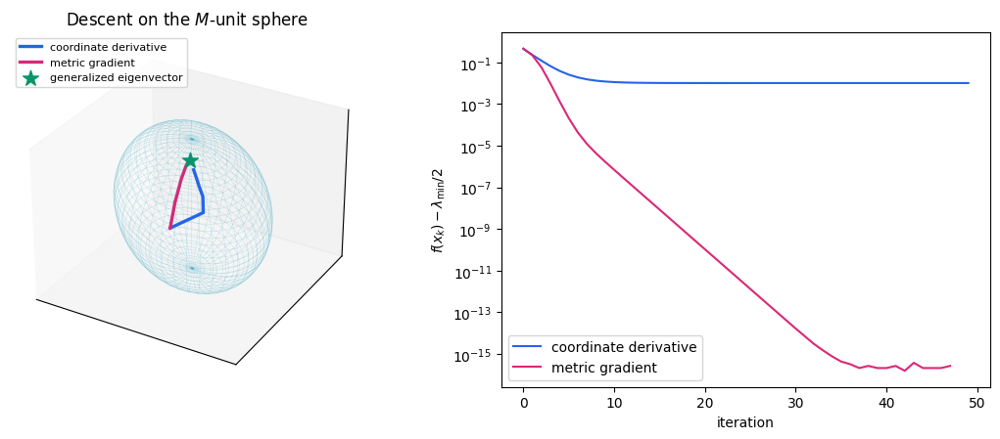

7 · Gradient descent on a manifold with non-Euclidean geometry
==============================================================

**Goal:** build the unit sphere of a metric M, a quadratic objective, and its
tangent projector, then minimise the objective with a hand-written Riemannian
gradient descent and match the smallest generalized eigenpair of (A, M).

**Before you start:** read :doc:`03_functionals` and :doc:`06_optimal_transport`.
Run the blocks in order in a fresh session; see :doc:`index` for setup.

1 · An ambient space whose geometry is M
----------------------------------------

Fix a symmetric positive-definite matrix M on the coordinates of
:math:`\mathbb{R}^3` and give the ambient space the inner product

.. math::

   \langle x, y\rangle_M = x^\top M y .

The Riesz map of this geometry multiplies by M and its inverse solves with M.
``OperatorInnerProduct`` takes both maps as operators on the Euclidean
coordinate space, so the metric is declared once, on the space.

.. code:: python

    import numpy as np
    import scipy.linalg
    import matplotlib.pyplot as plt
    import spacecore as sc

    BLUE, PINK, CYAN, GREEN = "#2563eb", "#db2777", "#0891b2", "#059669"

    ctx = sc.Context(sc.NumpyOps(), dtype=np.float64)
    ops = ctx.ops
    M = ctx.asarray([[2.0, 0.6, 0.0],
                     [0.6, 1.0, 0.0],
                     [0.0, 0.0, 1.3]])
    coords = sc.DenseVectorSpace((3,), ctx)
    metric = sc.DenseLinOp(M, coords, coords, ctx)
    inverse_metric = sc.DenseLinOp(np.linalg.inv(M), coords, coords, ctx)
    X = sc.DenseVectorSpace(
        (3,), ctx, geometry=sc.OperatorInnerProduct(metric, inverse_metric),
    )

    rng = np.random.default_rng(0)
    u, w = ctx.asarray(rng.standard_normal(3)), ctx.asarray(rng.standard_normal(3))
    np.testing.assert_allclose(X.inner(u, w), u @ M @ w)
    np.testing.assert_allclose(X.riesz(u), M @ u)
    np.testing.assert_allclose(X.riesz_inverse(X.riesz(u)), u)
    assert not X.is_euclidean

``coords`` is the Euclidean coordinate space that ``OperatorInnerProduct``
requires as the domain of M. Every later inner product, norm and gradient on
``X`` uses M without being told again.

2 · The M-sphere and its retraction
-----------------------------------

The manifold is the unit sphere of this geometry, an ellipsoid in coordinates:

.. math::

   \mathcal{S}_M=\{x:\langle x,x\rangle_M=1\},\qquad
   T_x\mathcal{S}_M=\{v:\langle x,v\rangle_M=0\},\qquad
   R(y)=y/\|y\|_M .

The tangent space is the M-orthogonal complement of x, obtained by
differentiating the constraint. The retraction R maps any nonzero ambient
point back to the sphere by normalising in the space norm.

.. code:: python

    def retract(y):
        return X.scale(1.0 / X.norm(y), y)

    x0 = retract(ctx.asarray([0.2, -0.9, 0.3]))
    X.check_member(x0)
    np.testing.assert_allclose(X.inner(x0, x0), 1.0)
    np.testing.assert_allclose(x0 @ M @ x0, 1.0)

``X.norm`` is the M-norm, so the retracted point has unit M-norm and
generally not unit Euclidean norm. Points on the manifold are ordinary
members of ``X``; the constraint is enforced by the retraction, not by the space.

3 · The objective as a custom functional
----------------------------------------

Take a symmetric matrix A and the objective

.. math::

   f(x)=\tfrac12\,x^\top A x,\qquad \partial f(x)=Ax,\qquad
   \nabla_M f(x)=M^{-1}Ax .

The coordinate derivative Ax is a covector: it pairs with v as
:math:`(Ax)^\top v`. The metric gradient is the vector g with
:math:`\langle g,v\rangle_M=(Ax)^\top v`, which is ``riesz_inverse(A x)``.
On the sphere, :math:`2f(x)` is the generalized Rayleigh quotient
:math:`x^\top Ax/x^\top Mx`.

.. code:: python

    A = ctx.asarray([[3.0, 1.0, 0.0],
                     [1.0, 2.0, 0.5],
                     [0.0, 0.5, 1.0]])

    class HalfQuadratic(sc.Functional):
        """f(x) = x^T A x / 2 in coordinates, with the gradient in the space's metric."""

        _fields = ("A", "dom", "ctx")
        _dynamic = ("A",)

        def __init__(self, A, dom, ctx=None, check_level=None):
            super().__init__(dom, ctx, check_level=check_level)
            self.A = self.ctx.asarray(A)

        def _value_core(self, x):
            return 0.5 * self.ops.vdot(x, self.ops.matmul(self.A, x))

        def _grad_core(self, x):
            return self.domain.riesz_inverse(self.ops.matmul(self.A, x))

    f = HalfQuadratic(A, X)
    g = f.grad(x0)
    np.testing.assert_allclose(g, np.linalg.solve(M, A @ x0))

    h = 1e-6
    slope = (f.value(X.axpy(h, u, x0)) - f.value(X.axpy(-h, u, x0))) / (2 * h)
    np.testing.assert_allclose(slope, X.inner(g, u), rtol=1e-7)

The finite difference is the directional derivative of f along u; it equals
:math:`\langle\nabla_M f,u\rangle_M`, not the Euclidean dot product of g and u.
Only the two cores are custom: ``f.value`` and ``f.grad`` are the inherited,
checked public methods.

4 · The tangent projector as a linear operator
----------------------------------------------

For x on the sphere, the M-orthogonal projector onto the tangent space is

.. math::

   P_x v = v-\langle x,v\rangle_M\,x,\qquad
   \langle P_xv,w\rangle_M=\langle v,w\rangle_M-\langle x,v\rangle_M\langle x,w\rangle_M .

The right-hand side is symmetric in v and w, so :math:`P_x` is self-adjoint in
the M geometry and its adjoint core is the same map. The Riemannian gradient is
:math:`\operatorname{grad} f(x)=P_x\nabla_M f(x)`.

.. code:: python

    class TangentProjector(sc.LinOp):
        """v -> v - <x, v> x on a space where x has unit norm."""

        _fields = ("x", "space:domain", "ctx")
        _dynamic = ("x",)

        def __init__(self, x, space, ctx=None, check_level=None):
            super().__init__(space, space, ctx, check_level=check_level)
            self.x = x

        def _apply_core(self, v):
            return self.domain.axpy(-self.domain.inner(self.x, v), self.x, v)

        def _rapply_core(self, v):
            return self._apply_core(v)          # self-adjoint in the space's metric

    P = TangentProjector(x0, X)
    np.testing.assert_allclose(P.apply(P.apply(u)), P.apply(u))
    np.testing.assert_allclose(X.inner(P.apply(u), w), X.inner(u, P.apply(w)))
    np.testing.assert_allclose(P.H.apply(u), P.apply(u))

    rgrad = P.apply(f.grad(x0))
    assert abs(X.inner(x0, rgrad)) < 1e-12
    assert abs(x0 @ rgrad) > 1e-2

The first three assertions are idempotence, M-self-adjointness, and agreement
of the adjoint view with the forward map. The last two show the Riemannian
gradient is tangent in the M-inner product but not Euclidean-orthogonal to x.

5 · Check the Riemannian gradient along a retraction curve
----------------------------------------------------------

For a tangent vector v, the curve :math:`c(t)=R(x+tv)` stays on the sphere,
has :math:`c(0)=x` and :math:`c'(0)=v`. Hence

.. math::

   \tfrac{d}{dt}f(c(t))\big|_{t=0}=\langle\operatorname{grad} f(x),v\rangle_M .

.. code:: python

    v = P.apply(u)

    def along_curve(t):
        point = retract(X.axpy(t, v, x0))
        np.testing.assert_allclose(X.norm(point), 1.0)
        return f.value(point)

    curve_slope = (along_curve(h) - along_curve(-h)) / (2 * h)
    np.testing.assert_allclose(curve_slope, X.inner(rgrad, v), rtol=1e-7)

Every point of the curve lies on the sphere, so the finite difference measures
the derivative of f restricted to the manifold. The ambient gradient ``g``
would pass the same test, since ``g - rgrad`` is a multiple of x and
:math:`\langle x_0,v\rangle_M=0`; what singles out ``rgrad`` is that it is
itself tangent.

6 · Hand-written Riemannian gradient descent
--------------------------------------------

Each step projects, steps and retracts:

.. math::

   x_{k+1}=R\bigl(x_k-\eta\,P_{x_k}\nabla_M f(x_k)\bigr).

Its fixed points satisfy :math:`M^{-1}Ax=\lambda x`, so the minimiser is the
generalized eigenvector of :math:`Ax=\lambda Mx` with the smallest eigenvalue,
and :math:`f=\lambda_{\min}/2` there. At that point the Riemannian Hessian has
eigenvalues :math:`\lambda_i-\lambda_{\min}`, so a step with
:math:`\eta(\lambda_{\max}-\lambda_{\min})<2` contracts locally.

.. code:: python

    def descend(gradient, x, eta=0.4, tol=1e-10, max_steps=500):
        path, values, norms = [np.array(x)], [f.value(x)], []
        for _ in range(max_steps):
            r = TangentProjector(x, X).apply(gradient(x))
            norms.append(X.norm(r))
            if norms[-1] < tol:
                return x, np.array(path), np.array(values), np.array(norms)
            x = retract(X.axpy(-eta, r, x))
            path.append(np.array(x)); values.append(f.value(x))
        raise RuntimeError("tangent gradient tolerance not reached")

    x_nat, path_nat, f_nat, r_nat = descend(f.grad, x0)

    lam, V = scipy.linalg.eigh(A, M)           # V.T @ M @ V = I
    assert 0.4 * (lam[-1] - lam[0]) < 2
    np.testing.assert_allclose(f.value(x_nat), lam[0] / 2, rtol=1e-12)
    np.testing.assert_allclose(abs(X.inner(x_nat, V[:, 0])), 1.0, atol=1e-9)
    np.testing.assert_allclose(f.grad(x_nat), lam[0] * x_nat, atol=1e-9)
    print("steps:", len(r_nat) - 1, " f:", f.value(x_nat), " lambda_min/2:", lam[0] / 2)

The loop stops on the M-norm of the Riemannian gradient. The final point is
the M-normalised eigenvector ``V[:, 0]`` up to sign, and the metric gradient
there is :math:`\lambda_{\min}x`, a normal vector to the sphere.

7 · What the metric changes
---------------------------

Run the same loop with the coordinate derivative ``A @ x`` in place of the
metric gradient, keeping the M-projector. Its fixed points satisfy
:math:`Ax=cx`: ordinary eigenvectors of A, M-normalised, which are not
generalized eigenvectors when A and M do not commute.

.. code:: python

    x_mix, path_mix, f_mix, r_mix = descend(lambda x: A @ x, x0)

    coef = (x_mix @ A @ x_mix) / (x_mix @ x_mix)
    np.testing.assert_allclose(A @ x_mix, coef * x_mix, atol=1e-8)
    np.testing.assert_allclose(X.norm(x_mix), 1.0)
    assert f.value(x_mix) - lam[0] / 2 > 1e-3

    evals, evecs = np.linalg.eigh(M)
    M_half_inv = evecs @ np.diag(evals ** -0.5) @ evecs.T
    th, ph = np.mgrid[0:np.pi:40j, 0:2 * np.pi:40j]
    ell = np.einsum("ij,jkl->ikl", M_half_inv,
                    np.stack([np.sin(th) * np.cos(ph), np.sin(th) * np.sin(ph), np.cos(th)]))

    fig = plt.figure(figsize=(11, 4.6))
    ax = fig.add_subplot(1, 2, 1, projection="3d")
    ax.plot_wireframe(*ell, color=CYAN, alpha=0.18, linewidth=0.4)
    for path, color, label in [(path_mix, BLUE, "coordinate derivative"),
                               (path_nat, PINK, "metric gradient")]:
        ax.plot(*path.T, color=color, lw=2.4, label=label)
    ax.scatter(*x_nat, color=GREEN, s=140, marker="*", label="generalized eigenvector")
    ax.set_title("Descent on the $M$-unit sphere"); ax.legend(loc="upper left", fontsize=8)
    ax.set_xticks([]); ax.set_yticks([]); ax.set_zticks([])
    ax2 = fig.add_subplot(1, 2, 2)
    ax2.semilogy(f_mix - lam[0] / 2 + 1e-16, color=BLUE, label="coordinate derivative")
    ax2.semilogy(f_nat - lam[0] / 2 + 1e-16, color=PINK, label="metric gradient")
    ax2.set_xlabel("iteration"); ax2.set_ylabel(r"$f(x_k)-\lambda_{\min}/2$")
    ax2.legend(); plt.tight_layout(); plt.show()

Both runs stay on the ellipsoid and both stop with a tangent residual below
``1e-10``. Only the metric gradient reaches the minimum; the other run converges
to a feasible stationary point of the wrong problem, so feasibility and a
vanishing step do not certify optimality.

Check your understanding
------------------------

* Set M to the identity and rerun. Both loops should now coincide, and the
  answer should be the smallest eigenvector of A.
* Why may ``_rapply_core`` reuse ``_apply_core``? The expansion in section 4
  is symmetric in v and w for the M-inner product.
* Replace ``retract`` with Euclidean normalisation ``y / np.linalg.norm(y)``.
  Which assertion fails first, and why?
* Raise ``eta`` until :math:`\eta(\lambda_{\max}-\lambda_{\min})>2`. Expect the
  loop to stop converging to the minimiser.

**Next:** :doc:`8 · PDHG for a conic program <08_pdhg_conic_program>`
— operators, cones, and a primal–dual saddle point.
