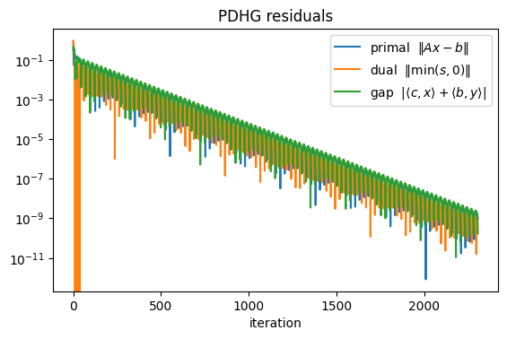
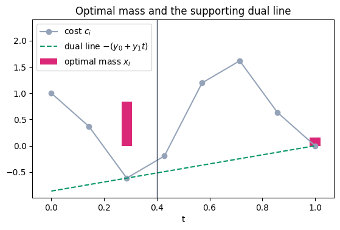

8 · PDHG for a conic program
============================

**Goal:** build a small linear program over the nonnegative orthant from
SpaceCore spaces, a custom constraint operator and proximal functionals.
Then solve it with a hand-written primal–dual hybrid gradient (PDHG) loop
and certify the answer against ``scipy.optimize.linprog``.

**Before you start:** read :doc:`02_linear_algebra` and :doc:`03_functionals`.
Run the blocks in order in a fresh session; see :doc:`index` for setup.

1 · The program and its spaces
------------------------------

Put probability mass x on n grid points :math:`t_i\in[0,1]`. Each point
has a cost :math:`c_i`; the mass must sum to one and have mean
:math:`\mu`:

.. math::

   \min_{x\in\mathbb{R}^n}\ \langle c,x\rangle
   \quad\text{s.t.}\quad Ax=b,\quad x\in\mathcal{K}=\mathbb{R}^n_{\geq0},
   \qquad Ax=\Big(\sum_ix_i,\ \sum_it_ix_i\Big),\quad b=(1,\mu).

This is a conic program with the orthant as cone: a linear program in
standard form. The primal x lives in :math:`X=\mathbb{R}^n`, the
multiplier y of the two equalities in :math:`Y=\mathbb{R}^2`.

.. code:: python

    import numpy as np
    import matplotlib.pyplot as plt
    from scipy.optimize import linprog
    import spacecore as sc

    ctx = sc.Context(sc.NumpyOps(), dtype=np.float64)
    ops = ctx.ops
    n, mu = 8, 0.4
    grid = np.linspace(0.0, 1.0, n)
    t = ctx.asarray(grid)
    c = ctx.asarray(np.cos(3 * np.pi * grid) + grid)
    b = ctx.asarray([1.0, mu])

    X = sc.DenseCoordinateSpace((n,), ctx)
    Y = sc.DenseCoordinateSpace((2,), ctx)
    X.check_member(c)
    Y.check_member(b)
    assert grid[0] <= mu <= grid[-1]          # some x >= 0 has mean mu

The last assertion guarantees feasibility: mass split between the end
points 0 and 1 attains any mean in between. Both spaces carry the
Euclidean inner product, so the orthant projection below is
coordinatewise and the adjoint is the transpose.

2 · The constraint operator from cores
--------------------------------------

The adjoint of A follows from expanding the pairing:

.. math::

   \langle Ax,y\rangle_Y=y_0\sum_ix_i+y_1\sum_it_ix_i
   =\sum_ix_i(y_0+y_1t_i),
   \qquad A^\#y=y_0\mathbf1+y_1t.

A subclass of ``sc.LinOp`` writes these two maps as check-free cores;
the inherited ``apply``, ``rapply`` and ``A.H`` check their inputs and
call them.

.. code:: python

    class MomentOp(sc.LinOp):
        """x -> (sum x, sum t x): total mass and first moment on a grid."""

        _fields = ("t", "dom", "cod", "ctx")
        _dynamic = ("t",)

        def __init__(self, t, dom, cod, ctx=None, check_level=None):
            super().__init__(dom, cod, ctx, check_level=check_level)
            self.t = self.ctx.asarray(t)

        def _apply_core(self, x):
            return self.ops.stack([self.ops.sum(x), self.ops.sum(self.t * x)])

        def _rapply_core(self, y):
            return y[0] + y[1] * self.t

    A = MomentOp(t, X, Y)

    rng = np.random.default_rng(0)
    x_test = ctx.asarray(rng.standard_normal(n))
    y_test = ctx.asarray(rng.standard_normal(2))
    np.testing.assert_allclose(Y.inner(A.apply(x_test), y_test),
                               X.inner(x_test, A.H.apply(y_test)), atol=1e-12)
    A_dense = np.vstack([np.ones(n), grid])
    np.testing.assert_allclose(A.to_dense(), A_dense)

The first assertion is the adjoint identity on random elements; the
second compares the materialised operator with the 2 × n matrix written
by hand. PDHG never uses ``A_dense``; ``linprog`` does in section 6.

3 · Objective and constraints as proximal functionals
-----------------------------------------------------

Write the program as :math:`\min_x G(x)+F(Ax)` with

.. math::

   G(x)=\langle c,x\rangle+\iota_{\mathcal{K}}(x),\qquad
   F=\iota_{\{b\}},\qquad F^*(y)=\langle b,y\rangle.

Here :math:`\iota_S` is zero on S and :math:`+\infty` off it. PDHG needs
:math:`\operatorname{prox}_{\tau G}` and :math:`\operatorname{prox}_{\sigma F^*}`.
SpaceCore has a prox rule for an indicator, namely the set's projection,
but none for a sum with a linear term. Completing the square gives the
shift instead:

.. math::

   \operatorname{prox}_{\tau G}(v)
   =\arg\min_{z\geq0}\langle c,z\rangle+\tfrac{1}{2\tau}\|z-v\|^2
   =\operatorname{prox}_{\tau\iota_{\mathcal{K}}}(v-\tau c).

For :math:`F^*`, ``F.conjugate_prox`` applies the Moreau identity
:math:`\operatorname{prox}_{\sigma F^*}(w)=w-\sigma\operatorname{prox}_{F/\sigma}(w/\sigma)=w-\sigma b`.
The singleton :math:`\{b\}` is not built in, so we write it as a ``Set``.

.. code:: python

    class Point(sc.Set):
        """The closed convex set {p} in its ambient space."""

        _fields = ("p", "ambient", "check_level")
        is_convex = True

        def __init__(self, p, ambient, *, check_level=None):
            super().__init__(ambient, check_level=check_level)
            self.p = p

        def contains(self, y):
            return self.ops.xp.all(y == self.p)

        def project(self, y):
            return self.p

    linear = sc.InnerProductFunctional(c, X)
    K = sc.IndicatorFunctional(sc.NonnegativeOrthant(X))
    F = sc.IndicatorFunctional(Point(b, Y))

    try:
        (linear + K).prox(x=c, step=0.5)
    except sc.CapabilityError:
        pass
    else:
        raise AssertionError("a sum with a linear term has no prox rule")

    def prox_G(v, tau):
        return K.prox(x=X.axpy(-tau, c, v), step=tau)

    v, tau = ctx.asarray(rng.standard_normal(n)), 0.3
    z = prox_G(v, tau)
    g = X.add(c, X.scale(1 / tau, X.axpy(-1.0, v, z)))   # c + (z - v) / tau
    assert K.value(z) == 0.0 and np.all(g >= -1e-12)
    np.testing.assert_allclose(z * g, 0.0, atol=1e-12)

    w, sigma = ctx.asarray([0.3, -2.0]), 0.7
    np.testing.assert_allclose(F.conjugate_prox(w, sigma), Y.axpy(-sigma, b, w))
    assert F.value(b) == 0.0 and F.value(w) == np.inf

The ``try`` block confirms that SpaceCore refuses the sum rather than
guessing. The next three assertions are the optimality conditions of
the shifted prox: :math:`z\geq0`, :math:`g=c+(z-v)/\tau\geq0` and
:math:`z_ig_i=0`, i.e. :math:`-g\in N_{\mathcal{K}}(z)`. The last two
check the Moreau formula and the indicator's values.

4 · Step sizes from the operator norm
-------------------------------------

PDHG with extrapolation one converges for :math:`\tau\sigma\|A\|^2<1`
when a saddle point exists (Chambolle & Pock, "A First-Order Primal-Dual
Algorithm for Convex Problems with Applications to Imaging", Algorithm 1
and Theorem 1). Since :math:`\|A\|^2` is the top eigenvalue of
:math:`A^\#A`, power iteration on the composed operator estimates it.

.. code:: python

    norm_sq = sc.power_iteration(A.H @ A, tol=1e-12, maxiter=500).eigenvalue
    np.testing.assert_allclose(norm_sq, np.linalg.norm(A_dense, 2) ** 2, rtol=1e-10)
    tau = sigma = 0.95 / float(np.sqrt(norm_sq))
    assert tau * sigma * norm_sq < 1

``A.H @ A`` is a lazy composite of the custom operator and its adjoint;
no 8 × 8 matrix is formed for the estimate.

5 · The PDHG loop
-----------------

One iteration reads

.. math::

   x^{k+1}=\operatorname{prox}_{\tau G}(x^k-\tau A^\#y^k),\qquad
   \bar x=2x^{k+1}-x^k,\qquad
   y^{k+1}=\operatorname{prox}_{\sigma F^*}(y^k+\sigma A\bar x).

The dual of the program is :math:`\max_y -\langle b,y\rangle` subject to
:math:`s=c+A^\#y\geq0`. Stop when three residuals are small: primal
infeasibility :math:`\|Ax-b\|`, dual infeasibility
:math:`\|s-\max(s,0)\|`, and the gap
:math:`|\langle c,x\rangle+\langle b,y\rangle|`.

.. code:: python

    x, y = X.zeros(), Y.zeros()
    history = []
    for k in range(20000):
        x_new = prox_G(X.axpy(-tau, A.H.apply(y), x), tau)
        x_bar = X.axpy(-1.0, x, X.scale(2.0, x_new))
        y = F.conjugate_prox(Y.axpy(sigma, A.apply(x_bar), y), sigma)
        x = x_new

        s = X.add(c, A.H.apply(y))
        primal = float(Y.norm(Y.axpy(-1.0, b, A.apply(x))))
        dual = float(X.norm(X.axpy(-1.0, K.prox(x=s, step=1.0), s)))
        gap = abs(float(linear.value(x) + Y.inner(b, y)))
        history.append((primal, dual, gap))
        if max(primal, dual, gap) < 1e-9:
            break
    else:
        raise RuntimeError("PDHG tolerance not reached")

    print("iterations:", k + 1)
    print("x:", np.round(x, 6))
    print("objective:", float(linear.value(x)))

    fig, ax = plt.subplots(figsize=(6.4, 3.8))
    for series, label in zip(np.array(history).T,
                             ["primal  $\\|Ax-b\\|$", "dual  $\\|\\min(s,0)\\|$",
                              "gap  $|\\langle c,x\\rangle+\\langle b,y\\rangle|$"]):
        ax.semilogy(series, label=label)
    ax.set_xlabel("iteration"); ax.set_title("PDHG residuals"); ax.legend()
    plt.show()

Every primal iterate is nonnegative, because it leaves ``K.prox``; the
equality constraints and dual feasibility hold only in the limit. The
loop calls only space operations, the operator and its adjoint, and the
two prox maps.

6 · Certify against linprog
---------------------------

A small gap alone does not certify optimality; it must come with primal
and dual feasibility. Assert all three, then compare with the HiGHS
solver in ``linprog`` on the dense matrix.

.. code:: python

    s = X.add(c, A.H.apply(y))
    assert K.value(x) == 0.0
    np.testing.assert_allclose(A.apply(x), b, atol=1e-8)
    assert np.all(s >= -1e-8)
    np.testing.assert_allclose(linear.value(x), -Y.inner(b, y), atol=1e-8)

    reference = linprog(np.asarray(c), A_eq=A_dense, b_eq=np.asarray(b),
                        bounds=(0, None), method="highs")
    assert reference.status == 0
    np.testing.assert_allclose(linear.value(x), reference.fun, atol=1e-8)
    np.testing.assert_allclose(x, reference.x, atol=1e-6)
    np.testing.assert_allclose(y, -reference.eqlin.marginals, atol=1e-6)
    print("support:", grid[x > 1e-6], "weights:", x[x > 1e-6])

    fig, ax = plt.subplots(figsize=(6.4, 3.8))
    ax.plot(grid, c, "o-", color="#94a3b8", label="cost $c_i$")
    ax.plot(grid, -(y[0] + y[1] * grid), "--", color="#059669",
            label="dual line $-(y_0+y_1t)$")
    ax.bar(grid, x, width=0.04, color="#db2777", label="optimal mass $x_i$")
    ax.axvline(mu, color="#334155", lw=1)
    ax.set_xlabel("t"); ax.set_title("Optimal mass and the supporting dual line")
    ax.set_ylim(top=2.4); ax.legend(loc="upper left"); plt.show()

The dual slack :math:`s_i=c_i-\ell(t_i)` with
:math:`\ell(t)=-(y_0+y_1t)` is nonnegative, so the dual line lies under
every cost point. Complementarity :math:`x_is_i=0` puts all mass on
points where the line touches. Here this is the two grid points
:math:`t=2/7` and :math:`t=1`, with weights 0.84 and 0.16: their mean is
:math:`0.4=\mu`. The multiplier sign is opposite to ``linprog``'s
``eqlin.marginals`` because the saddle uses :math:`+\langle Ax,y\rangle`.

Check your understanding
------------------------

* Why does ``prox_G`` subtract :math:`\tau c` before projecting rather
  than after? Shifting after the projection, :math:`\max(v,0)-\tau c`,
  leaves the orthant wherever :math:`c_i>0` and :math:`v_i\leq0`.
* Why does the optimum use at most two grid points? A vertex of
  :math:`\{x\geq0,\ Ax=b\}` has at most as many nonzeros as A has rows.
* Set ``tau = sigma = 1.5 / np.sqrt(norm_sq)`` and rerun section 5. The
  step condition fails; record whether the residuals still decrease.
* Replace ``Point(b, Y)`` by a box :math:`\{l\leq y\leq u\}` set to model
  inequality constraints :math:`l\leq Ax\leq u`. Only ``project`` and
  ``contains`` change in the set and ``F.conjugate_prox`` in the loop is
  unchanged; the gap must then use the support function of the box.

**Next:** :doc:`09_kernels_and_fusion` shows when an operator expression
such as ``A.H @ A`` is worth materialising.
